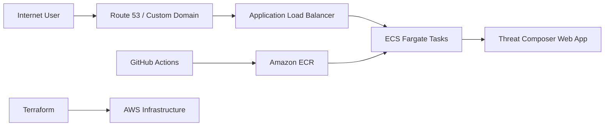

# AWS Threat Composer App

## Deployment with ECS, Fargate, Terraform and GitHub Actions

## Introduction

This project demonstrates how to deploy a containerised web application to AWS using a modern, production-style infrastructure setup. I used Docker to package the app, GitHub Actions to automate the build and push process to Amazon ECR, and Terraform to provision and manage the AWS infrastructure required to run the application reliably at scale.

The stack includes:

- Amazon ECS for container orchestration
- AWS Fargate for serverless container hosting
- Application Load Balancer (ALB) for traffic distribution
- Amazon Route 53 for DNS management
- Amazon Certificate Manager (ACM) for HTTPS
- Terraform for infrastructure as code
- GitHub Actions for CI/CD automation

The goal is to deliver a highly available, secure, and scalable web application that is accessible through a custom domain with HTTPS enabled.

## Architecture Overview

The application is deployed in a VPC with public subnets, behind an ALB and running on ECS Fargate tasks. GitHub Actions builds the Docker image from the application source, pushes it to Amazon ECR, and Terraform then deploys the updated task definition and supporting AWS resources.



## Key Features

- Containerised deployment using Docker
- Serverless compute with AWS Fargate
- Automated CI/CD pipeline with GitHub Actions
- Infrastructure managed as code with Terraform
- HTTPS termination through ALB and ACM
- Custom domain support via Route 53
- Scalable and repeatable AWS deployment model

## Technologies Used

- AWS ECS
- AWS Fargate
- Amazon ECR
- Application Load Balancer
- Route 53
- ACM
- Terraform
- GitHub Actions
- Docker
- Python/Flask or web application stack used by the project

## Repository Structure

```text
.
├── app/                 # Application source code and Docker assets
├── terraform/           # Terraform modules and configuration
├── .github/             # GitHub Actions workflows
├── README.md            # Project documentation
├── .gitignore
├── LICENSE
└── ...
```

## Deployment Workflow

1. Application code is developed and committed to GitHub.
2. GitHub Actions triggers a workflow on code changes.
3. The workflow builds the Docker image for the app.
4. The image is pushed to Amazon ECR.
5. Terraform config provisions or updates the ECS, Fargate, ALB, networking, and DNS resources.
6. ECS schedules the updated container tasks.
7. The application becomes available on the configured domain over HTTPS.

## Prerequisites

Before deploying this project, ensure you have:

- An AWS account with sufficient permissions
- Terraform installed locally
- Docker installed locally
- AWS CLI configured
- A custom domain managed in Route 53 (optional but recommended)
- GitHub repository access and GitHub Actions enabled

## Example Deployment Commands

```bash
# Initial Terraform setup
terraform init
terraform plan
terraform apply
```

## Notes

This project is designed to showcase a practical AWS deployment pattern for a container-based application. It combines infrastructure automation, DevOps workflows, and secure web hosting to provide a real-world deployment experience.

## License

This project is licensed under the MIT License. See the LICENSE file for details.
